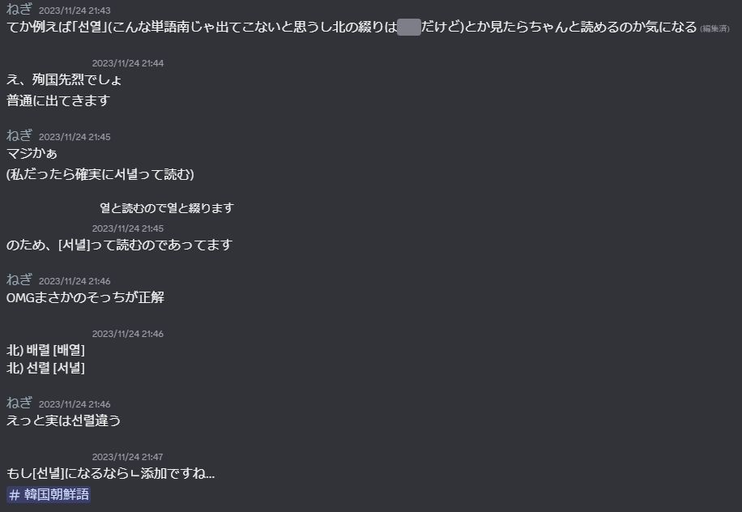
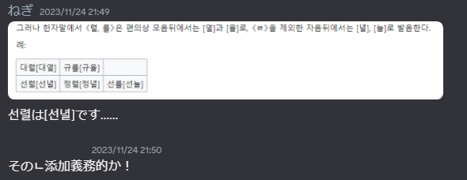

<nav class="page-nav"><a href="03.html">← 第3回</a>　<a href="index.html">目次にもどる</a>　<a href="05.html">第5回 →</a></nav>

# 分かち書き
分かち書きに関しては南よりも分かたない傾向があります。

概ね
①品詞が互いに違えば分ける。ただし、-하다(～する、～な), -되다(～される、～な), -시키다(～させる)などは分けない。

②토の後ろは分ける。
③品詞が違っていたり、토のあとであってもそれで1つの対象を表す場合は分けない。
例: 붉은기(赤い+旗)

:<: b 補足

明白な規定やその解説は存在しているが、そうしたものを頭に入れるよりは実例で慣れてしまったほうが正直早いし楽である。

続け書きしたときに意味が変わってしまうものは、意味が通るように書く。一部、分かち書きする場合もある。
例:
리정희어머니(リ･ジョンヒという名前の母親)
리정희 어머니(リ･ジョンヒという人物の母親)
중세언어 연구(中世言語 研究)
중세 언어연구(中世 言語研究)

基本的に分けるものが登場しない場合は、続け書きしたときに意味が変わってしまわなければ理論上無限に続け書くことができるが、あまりにも長くなって読みに不便を生ずる場合は意味単位で分けることが許容される。
例:
続け書き: 삼대혁명붉은기쟁취운동궐기모임참가자들
許容: 삼대혁명붉은기쟁취운동 궐기모임 참가자들
訳: 三大革命赤旗争取運動蹶起集会参加者たち

思うに、後部要素の自立性が低い場合にこのような書き方が好まれるのではないだろうか。
例:
노랑색(黄-色), 부른색(青-色), 우리식(我々式)

:>:

# 漢字音の差異
原漢字音のまま書くことが原則です。
국가(國家), 녀자(女子), 뇨소(尿素), 당(黨), 락원(樂園), 로동(勞動), 례외(例外), 천리마(千里馬), 풍모(風貌)

ただし、一部の単語は変化した後の音で表記します。
궁냥(窮量, 궁<b>량</b>)
나사(螺絲, <b>라</b>사)
나팔(喇叭, <b>라</b>팔)
류월(六月, <b>륙</b>월)
시월(十月, <b>십</b>월)
오뉴월(五六月, 오<b>륙</b>월)

また、原漢字音が《렬》,《률》であるものは母音の後ろ及び、《ㄹ》を除くすべての子音の後ろで発音が変化しますが、そのまま綴ります。
母音の後: [열, 율]
대렬 [대열] (隊列)
규률 [규율] (規律)

ㄹを除くすべての子音の後: [녈, 뉼]
선렬 [선녈] (先烈) (南: 선열 [서녈])
정렬 [정녈] (整列)
선률 [선뉼] (旋律) (南: 선율 [서뉼])
:<: b 補足
つまるところ[렬, 률]という発音が残っているのはㄹパッチムの後だけである。
:<: b 補足の補足

南側はハングル正書法第11項の附則1で"母音やㄴパッチムに続く렬, 률は열, 율と書く"と定めており、普通に連音するため発音が北と異なる。

母語話者がこの違いを知らずに驚いており、その驚きにねぎが驚いたということもあった。

なお、前述の通り規定では《ㄴ添加(ㄴ挿入)》として処理されていない。だが、韓国語母語話者にはそのように感じられるのだろう。

:>:
:>:

漢字語で母音《ㅖ》が付く音節としては《계》, 《례》, 《혜》, 《예》だけを認めます。
계산(計算), 계획(計劃), 세계(世界)
례절(禮節), 례외(例外), 실례(實例, 失禮)
혜택(惠澤), 지혜(智慧)
예술(藝術), 예지(睿智, 豫知, 睿旨), 예약(豫約)

ただし、元の音が《게》である漢字はそのまま書きます。
게시판(揭示板), 게재(揭載), 게양대(揭揚臺)

:<: b 補足
南では母音"ㅖ"が付く漢字音として"몌(袂)", "폐(廢, 閉, 幣 など多数)"も認めているが、北はこれを採用しておらず、代わりに《ㅔ》で綴る。

袂別[메별] 北: <b>메</b>별 南: <b>몌</b>별

廢止[페지] 北: <b>페</b>지 南: <b>폐</b>지

:>:

漢字語で母音《ㅢ》が付く音節としては《희》, 《의》だけを認めます。
희망(希望), 순희(純犧), 유희(遊戱)
회의(會議), 의견(意見), 의의(意義)

https://fengnegi.github.io/KR-KP_hanja_lookup/ 

# 曲用･活用と토
日本語において、用言に｢ない｣｢たい｣｢とき｣｢ば｣といった接辞が続くとき、その接辞は用言が特定の形に変化してから付き、その形は用言や接辞によっていくつか形が決まっている。
これと同じものが文化語にも存在する。
この項では｢語基｣と｢토｣という概念を導入しながら、体言の曲用と用言の活用について<b>軽く</b>見ていく。

Q. なぜ<b>軽く</b>なのか？
A. 曲用･活用および토は文化語の根幹をなすものであるからして、ここにすべてを注ぎ込むことは物理的に不可能であるため。

## 語基

√V -다
√V = Ⅰ
√V = (-으-) Ⅱ
√V=  -아/어/여 Ⅲ
か

しかも今回[語幹]をちょうど[V, ㄹ]、[濃音]、[激音]で分けていて、Ⅰ･Ⅱにおいてパッチムが脱落する事がある(=一般的な｢母音語幹｣と同じ挙動になる)ものをㄹ語幹として吸収できている！

<nav class="page-nav"><a href="03.html">← 第3回</a>　<a href="index.html">目次にもどる</a>　<a href="05.html"> →第5回</a></nav>