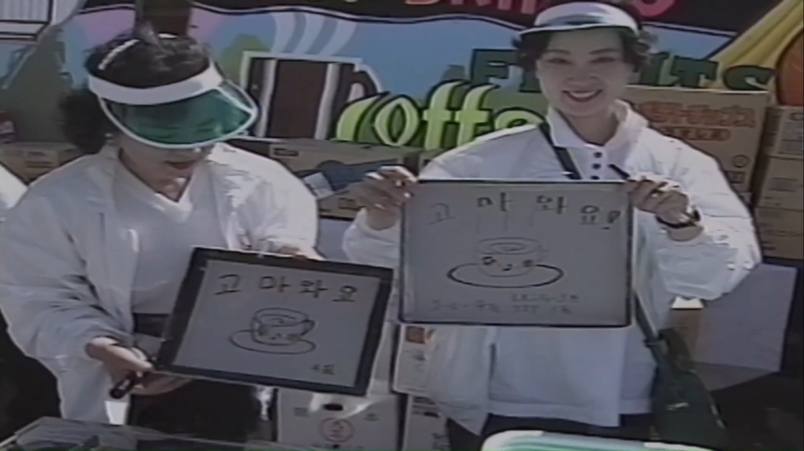

<nav class="page-nav"><a href="04.html">← 第4回</a>　<a href="index.html">目次にもどる</a>　<a href="06.html">第6回 →</a></nav>

# 語基
前回
:<: box 
日本語において、用言に｢ない｣｢たい｣｢とき｣｢ば｣といった接辞が続くとき、その接辞は用言が特定の形に変化してから付き、その形は用言や接辞によっていくつか形が決まっている。
これと同じものが文化語にも存在する。
:>:
と述べた。

ここでは、語基と토との関係性について実際に見ていく。

## 用言の分類と語基
次項から実際に語基を見ていくが、その前に用言の分類と語基を混同してはならないことを強調しておかなければならない。
前回の｢語基｣項にて、

としたことからもわかるように、韓国語と日本語、そして韓国語における韓国語での説明と日本語での説明で語幹の説明というのは指しているものにズレがある。
ここでは用言の原形から-다を取り除いた、活用において変化しない部分を｢語幹｣と呼び、これらから
* 母音･ㄹ語幹
* 子音語幹
の2つに大別する。

### 母音･ㄹ語幹
語幹が母音またはㄹ単独で終わっているもの。(※パッチムがㄹを含む2重パッチムである場合は子音語幹となる。)
例
가다: 行く
오다: 来る
주다: くれる、やる
서다: 立つ
들다: 掲げる
피다: 咲く
알다: 知る
살다: 暮らす、生きる、住む

### 子音語幹
母音･ㄹ語幹以外の、語幹が子音で終わっているもの。
例
놓다: 置く
않다: ～でない
잃다: 失う
담다: 込める
닮다: 似る
얹다: 載せる

## 3つの語基と主に続く토
文化語の用言には第Ⅰ～Ⅲ語基の3つが存在する。
数字の表記について特に決まりはないが、ローマ数字で書く慣習があるためここではそれに従う。
また、主に続く토の表記に関しても [語基]-[토] と表記する慣習があるため、それに従う。

* 第Ⅰ語基
形成
母音･ㄹ語幹、子音語幹のいずれとも用言の原形から末尾の-다を取り除いたもの。(つまり語幹そのもの。)
ㄹ語幹はいくつかの토の前で語幹のㄹが脱落するものがある。

    例
        主に続く토

        Ⅰ -고 ｢～して、｣
            主に後ろに動詞や特定の単語が続いて、続く動作と同時に起こっていることを表す。
            コピュラ｢이다｣はㄱが母音化して[이요]となる。

        Ⅰ -니 ｢～？｣
            疑問を表す。

        Ⅰ -는 ｢～する…｣
            主に後ろに体言を伴って現在の状態等を表す。

    주다: 주-, 주고, 주니, 주는
    쓰다: 쓰-, 쓰고, 쓰니, 쓰는
    하다: 하-, 하고, 하니, 하는
    되다: 되-, 되고, 되니, 되는
    살다: 살/사-, 살고, 사니, 사는
    놓다: 놓-, 놓고, 놓니, 놓는
    않다: 않-, 않고, 않니, 않는
    잃다: 잃-, 잃고, 잃니, 잃는
    담다: 담-, 담고, 담니, 담는
    닮다: 닮-, 닮고, 닮니, 닮는
    얹다: 얹-, 얹고, 얹니, 얹는

* 第Ⅱ語基
形成: 
母音･ㄹ語幹: 第Ⅰ語基と同形
子音語幹: 第Ⅰ語基に-으を付けたもの。

    例
        主に続く토

        Ⅱ -니 ｢～ので｣
            理由を表す。

        Ⅱ -면 ｢～れば｣
            仮定を表す。

    주다: 주-, 주니, 주면
    쓰다: 쓰-, 쓰니, 쓰면
    하다: 하-, 하니, 하면
    되다: 되-, 되니, 되면
    살다: 살/사-, 사니, 살면
    놓다: 놓으- 놓으니, 놓으면
    않다: 않으-, 않으니, 않으면
    잃다: 잃으-, 잃으니, 잃으면
    담다: 담으-, 담으니, 담으면
    닮다: 닮으-, 닮으니, 닮으면
    얹다: 얹으-, 얹으니, 얹으면

* 第Ⅲ語基
形成
基本的に語幹に-어を付けるが、直前の母音がㅏ,ㅗの場合は-아を、歴史的に/j/で終わる動詞語幹であったもの、及び하다(する)には-여を付ける。

    例
        主に続く토

        Ⅲ -서 ｢～し…｣
            -아/어/여とほぼ変わらず、後ろに用言等を伴って後続する用言が同時性を伴わない進行であることを示す。

        Ⅲ -요 ｢～です｣
            略体上称。丁寧な口語。ただし、하다や되다は하여요/되여요ではなく해요/돼요になる。

    주다: 주어-, 주어서, 주어요
    쓰다: 써-, 써, 써서 써요
    하다: 하여-, 하여서, 해요
    되다: 되여-, 되여서, 돼요
    살다: 살아-, 살아서, 살아요
    놓다: 놓아- 놓아서, 놓아요
    않다: 않아-, 않아서, 않아요
    잃다: 잃어-, 잃어서, 잃어요
    담다: 담어-, 담어서, 담아요
    닮다: 닮아-, 닮아서, 닮아요
    얹다: 얹어-, 얹어서, 얹어요

# 変格用言
ここまでは用言に一定の語幹を見出してそれをカテゴライズしてきたが、語幹部分に予測不能な干渉を引き起こす形で活用が実現される用言も存在し、それらは別で論じる必要がある。
ここからはそれらを｢変格用言｣と称して、その予測不能な干渉を見ていく。

## ㅂ変格用言
文化語の変格用言のうち、とりわけ頻繁に登場するものがㅂ変格用言である。
語幹がㅂで終わっている形容詞の大半が属しており、動詞はごく少数しか存在しない。
これらは第Ⅱ語基が-으ではなく-우が付いて形成される。
また、第Ⅲ語基が語幹が1音節の場合は語幹の母音がㅏ,ㅗならば-와、それ以外で-워が付いて形成され、語幹が2音節以上の場合は語幹がいかなる母音であろうと-워が付いて形成される。

例
곱다(きれいだ): 곱-, 고우-, 고와-
덥다(暑い): 덥-, 더우-, 더워-
고맙다(ありがたい): 고맙-, 고마우- 고마워-
즐겁다(楽しい): 즐겁-, 즐거우-, 즐거워-

-스럽다, -답다, -롭다で終わっている形容詞も軒並みㅂ変格用言に属する。

例
자랑스럽다(誇らしい): 자랑스럽-, 자랑스러우-, 자랑스러워-
아름답다(美しい): 아름답-, 아름다우-, 아름다워-
슬기롭다(賢い): 슬기롭-, 슬기로우-, 슬기로워-

:<: b 補足Ⅰ
中期朝鮮語において、ㅂで終わる語幹が第Ⅱ･第Ⅲ語基で弱化するという現象があり、表記としてㅸを用いた。

例
곱〯다〮(>現:곱다): 곱〯고〮, 고〯ᄫᅳ〮면〮, 고〯ᄫᅡ〮
덥〯다〮(>現:덥다): 덥〯고〮, 더ᄫᅳ〮면〮, 더ᄫᅥ〮
갓갑〯다〮(>現:가깝다(近い)): 갓갑〯고〮, 갓가ᄫᆞ〮면〮,갓가ᄫᅡ〮
즐〮겁다〮(>現:즐겁다): 즐〮겁고〮, 즐〮거〮ᄫᅳ면〮, 즐〮거ᄫᅥ〮

そしてこのㅸが後続する母音へ円唇化を引き起こし、現在のようになったのである。

ところで、これは日本語のハ行転呼と非常によく似ていないだろうか？
/kafa/(川)→/kaɸa/→/kaβa/→/kawa/
となったように。
:>:

:<: b 補足Ⅱ
規範では、語幹が2音節以上であっても1音節のときと同じように語幹の母音に応じて-와/워が付くとされている。

例
고맙다: 고맙-, 고마우-, 고마와-
가깝다: 가깝-, 가까우-, 가까와-

しかし、実例をそこまで見たことがないため、ここでは特記しなかった。

↓ねぎの知るほぼ唯一の事例
https://youtu.be/eigNf6vUxUU?si=osqosJvgz5ZkLcGY&t=2245

:>:

## ㄷ変格用言
語幹がㄷで終わっている動詞の一部が属しており、形容詞は存在しない。
第Ⅱ語基･第Ⅲ語基において語幹がㄹに交替する。
また、第Ⅲ語基は語幹がㅏであるものは-아が、それ以外は-어が付いて形成される。

例
닫다(駆ける): 닫-, 달으-, 달어
걷다(歩く): 걷-, 걸으-, 걸어-
듣다(聞く): 듣-, 들으-, 들어-
묻다(問う、訊く): 묻-, 물으-, 물어-

## ㅅ変格用言
語幹がㅅで終わっている動詞の一部が属しており、形容詞は낫다のみ。
第Ⅱ語基･第Ⅲ語基において語幹が完全に脱落するが、第Ⅱ語基が母音語幹のように第Ⅰ語基と同形にならず、子音語幹のように-으が付いて形成される。
また、第Ⅲ語基は語幹がㅏであるものは-아が、それ以外は-어が付いて形成される。

例
낫다(治る): 낫-, 나으-, 나아-
붓다(注ぐ): 붓-, 부으-, 부어-
긋다(線を引く): 긋-, 그으-, 그어-
잇다(続ける): 잇-, 이으, 이어-
낫다(ましだ): 낫-, 나으-, 나아-

:<: b 補足
｢이어-｣のように一見語幹が이に思えるものであっても、そもそも原形からして語幹が/j/終わりではないので、-여ではなく-어が付いている。逆に言えば、第Ⅲ語基で-여が付いているものは問答無用で母音語幹の用言である。
:>:

<nav class="page-nav"><a href="03.html">← 第3回</a>　<a href="index.html">目次にもどる</a>　<a href="06.html"> →第6回</a></nav>